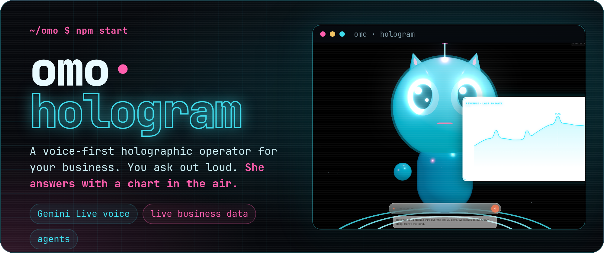
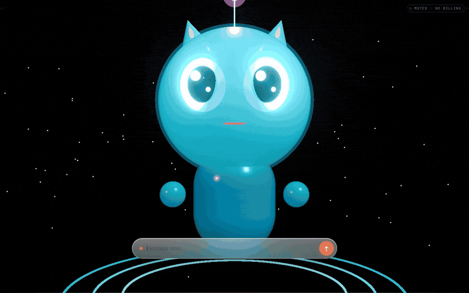
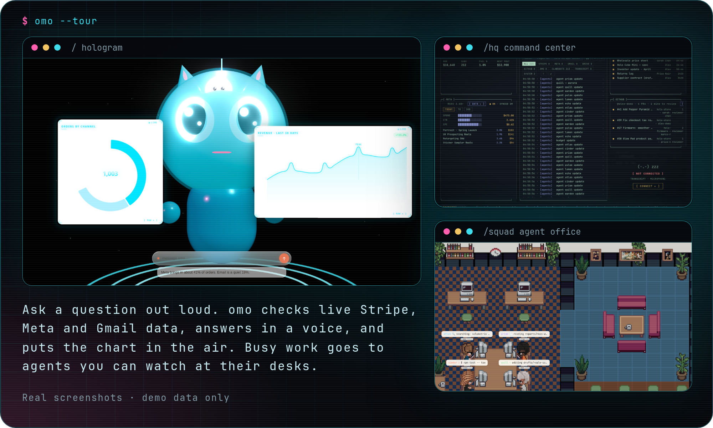
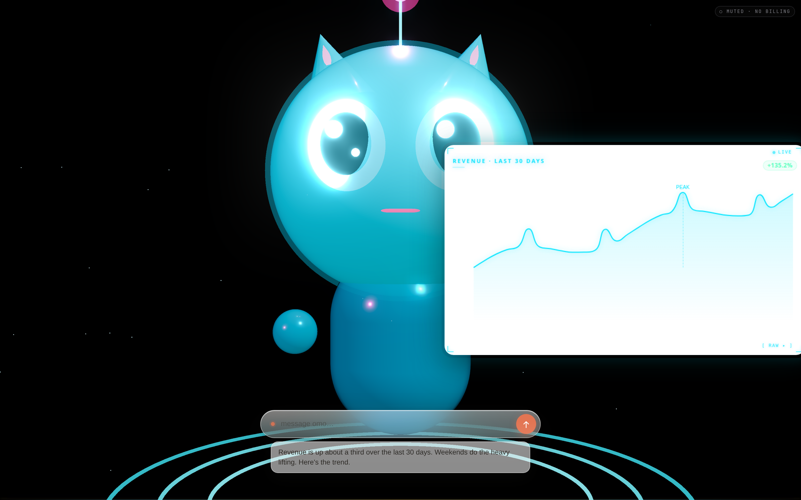
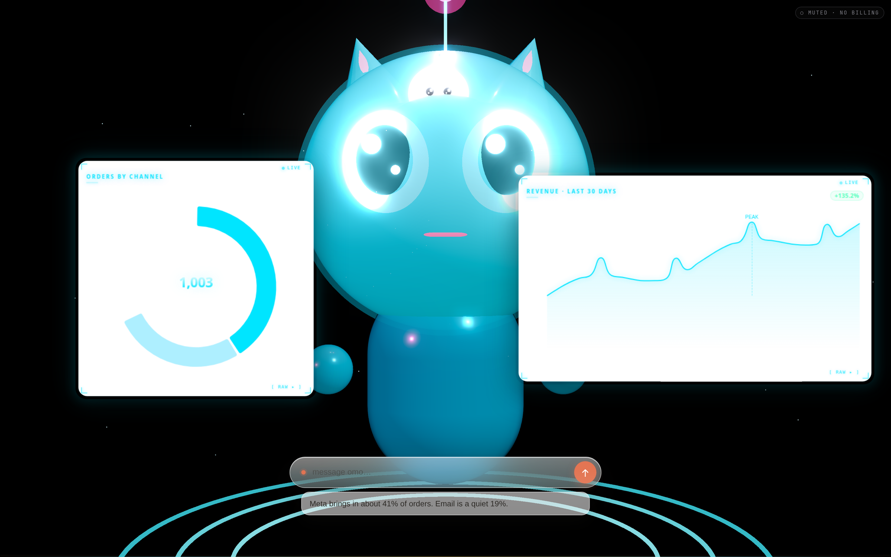
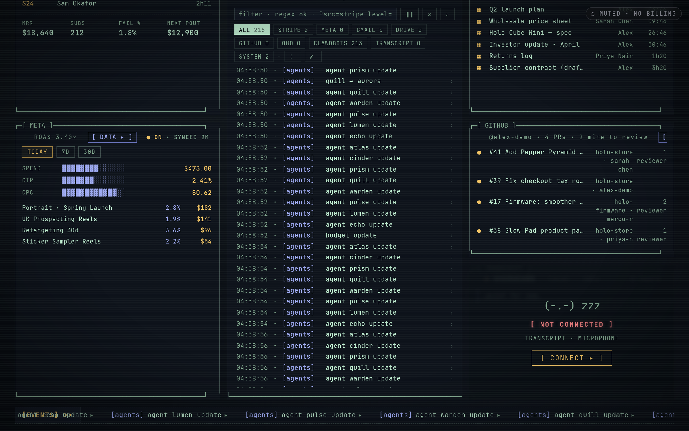
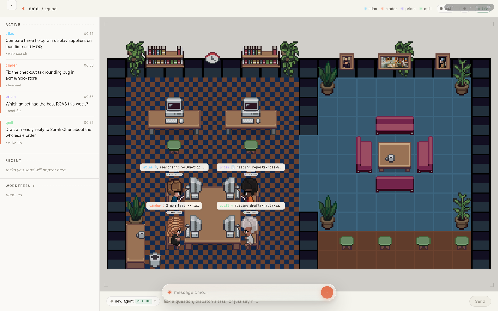

<div align="center">



<br />

[Quick start](#quick-start) · [What it does](#what-it-does) · [How it works](#how-it-works) · [Configuration](#configuration) · [Safety](#safety) · [Website](https://harrythentrepreneur.github.io/omo-hologram/)


</div>

You talk to omo out loud. She checks your live Stripe, Gmail, Drive, Calendar and Meta Ads data, answers in a voice, and puts the chart in the air beside her. When a job needs more than a quick answer, she hands it to small agents you can watch at their desks.

omo is an experiment from Omo Research. The question behind it: what if your business assistant lived on a display on your desk instead of in a browser tab?

<div align="center">

<br />
<sub>The real app, recorded headless. All data in the demo is invented.</sub>
</div>

## Quick start

You need Node 20+ and a [Gemini API key](https://aistudio.google.com/apikey).

```bash
git clone https://github.com/harrythentrepreneur/omo-hologram.git
cd omo-hologram
cp .env.example .env       # set GEMINI_API_KEY at minimum
npm install
npm start                  # http://localhost:8080
```

Every connector (Stripe, Meta Ads, Gmail/Drive, Neon, Tavily, Browserbase) is optional. If a connector has no credentials, it falls back to a mock or returns a clean "not configured" answer. The server boots with only a Gemini key.

No microphone? Open `http://localhost:8080/?text=1` for text mode. It has the same persona and tools, and it is a cheap way to test.

## What it does



### Ask out loud, get a chart in the air

Speech to speech runs on Google Gemini Live, with lip-sync on the avatar. Ask "how did revenue do this month?" and the answer comes back as a voice and a chart. The model never writes numbers into a chart itself. It gets a `viz_id`, and the server builds the chart from real data in a sandboxed iframe.



### Live business data

Built-in connectors for Stripe, Meta Ads, Gmail, Google Drive and Docs, Calendar, GitHub and Postgres (Neon). `data/seed.json` is a synthetic store (a made-up hologram hardware brand), so you can try the data tools without connecting a real business.



### HQ: the command center

`/hq` is a terminal-style board with Stripe, Meta, Gmail, Drive, GitHub and transcript panels. You can drive the drill-downs by voice.



### Squad: agents you can watch

Quick research runs in-process on Gemini. Live browser jobs run in Browserbase Chromium. `/squad` is a pixel-art office where each agent sits at a desk and shows what it is doing right now.



### More than one way to project

| Route | Display |
| --- | --- |
| `/` | Cylinder hologram (default) |
| `/reflector` | Reflector display |
| `/avatar` | Looking Glass-ready avatar |
| `/pyramid` | Pepper's-ghost pyramid |
| `/hq` | HQ command center |
| `/squad` | Squad agent office |
| `/?text=1` | Text mode, no microphone |

## How it works

```
 Browser (hologram page)                 Node server (server.js)                Outside world
 ───────────────────────                 ───────────────────────                ─────────────
 mic → PCM 16 kHz ─────────▶ Gemini Live (ephemeral token from POST /session)
 ◀── voice 24 kHz ────────── │
 function_call ─────────────▶ POST /tool → src/tools/index.js ───────────────▶ Stripe · Meta · Google · Neon
 <iframe src=/viz/:id> ◀──── chart HTML built by src/kitchen
 transcripts ───────────────▶ /omo/ingest → event bus (/omo/ws) ─────────────▶ HQ · Squad · agents grid
```

1. The page calls `POST /session`. The server mints a short-lived Gemini token, already bound to the persona, tools and voice. Your real `GEMINI_API_KEY` never reaches the browser.
2. Audio streams directly between the browser and Gemini. When the model calls a tool, the browser forwards the call to `/tool`.
3. Chart tools return a `viz_id`, and the browser mounts `/viz/:id`. The "kitchen" (`src/kitchen/`) fills a hand-built template with real data. It only falls back to generated HTML when no template fits.
4. Transcripts and connector events go onto one event bus (`/omo/ws`). That bus drives HQ, Squad and the agent grid.

[`CLAUDE.md`](CLAUDE.md) is the detailed map: request flow, the tool contract, kitchen rules, the agent bus, and recipes for adding a tool or connector.

## Configuration

All settings live in `.env`. [`.env.example`](.env.example) documents every variable.

| Variable | What it enables |
| --- | --- |
| `GEMINI_API_KEY` | **Required.** Voice session and chart generation |
| `GEMINI_VOICE`, `GEMINI_LANGUAGE` | Voice and default language (`Leda`, `cmn-CN`) |
| `STRIPE_SECRET_KEY` | Read-only Stripe ingest (use a *restricted* key) |
| `GOOGLE_OAUTH_*`, `GOOGLE_REFRESH_TOKEN` | Gmail, Drive, Docs, Calendar |
| `FB_ACCESS_TOKEN`, `FB_AD_ACCOUNT_ID` | Meta Ads campaigns and insights |
| `NEON_DB_DATABASE` | Postgres for orders and customers (seeded from `data/seed.json`) |
| `BROWSER_API_KEY`, `BROWSER_PROJECT_ID` | Browserbase browser agents |
| `TAVILY_API_KEY` | Web search tool |
| `GITHUB_TOKEN`, `GITHUB_REPOS` | GitHub panel on HQ |
| `PORT`, `HOST` | Server port (`8080`) and bind address (`127.0.0.1`) |

The voice speaks Simplified Chinese by default. Set `GEMINI_LANGUAGE` to change it.

## Safety

- **The server binds to `127.0.0.1` by default.** It can open agent terminals and read connected business data, so set `HOST=0.0.0.0` only on a network you trust.
- **It has no auth of its own.** There is no login. Put your own auth in front of it before you expose it anywhere.
- **`gmail_send` sends real mail.** When Gmail is connected, that tool sends real email. Leave Gmail unconnected, or use a test account, while you experiment.
- **Use read-only keys where you can.** The Stripe connector expects a restricted read-only key.
- **The browser never sees your API keys.** It only gets short-lived Gemini tokens, and charts render inside sandboxed iframes.

## Project layout

```
server.js            Express + WebSocket entry point
src/session.js       Persona, tool schemas, ephemeral-token minting
src/tools/           Tool registry (data, actions, charts, agents, GitHub, Hermes)
src/connectors/      Stripe, Meta, Gmail, Drive, Docs, GitHub, Neon
src/kitchen/         Chart and card templates + HTML fallback generator
src/agents/          Research and Browserbase agent runners
src/runtimes/        Optional Claude Code / Hermes Agent terminal runtimes
public/              Hologram pages, HQ, Squad, text mode
data/seed.json       Synthetic demo business
docs/                Screenshots, demo and the project website (GitHub Pages)
```

## Status

This is a research prototype, not a product. Testing is a smoke script (`node src/kitchen/__smoke.js`) and a lint pass (`npm run lint`). The ambient "always listening" mode is a deliberate stub (`src/momo/ambient.js`). Expect rough edges.

## Credits

- Built by [Harry Edwards](https://github.com/harrythentrepreneur) at Omo Research.
- Voice by Google Gemini Live. Browser agents by Browserbase.
- The Squad pixel office (`public/squad/`) is adapted from [Pixel Agents](https://github.com/pablodelucca/pixel-agents) by Pablo De Lucca (MIT). Its character sprites are based on the [Metro City](https://jik-a-4.itch.io/metrocity-free-topdown-character-pack) free character pack by JIK-A-4. See [NOTICE](NOTICE).
- Website and banner type: [JetBrains Mono](https://github.com/JetBrains/JetBrainsMono) (SIL OFL 1.1, `docs/fonts/OFL.txt`).
- Screenshots and the demo are the real app, captured with invented demo data.

## License

[MIT](LICENSE)
